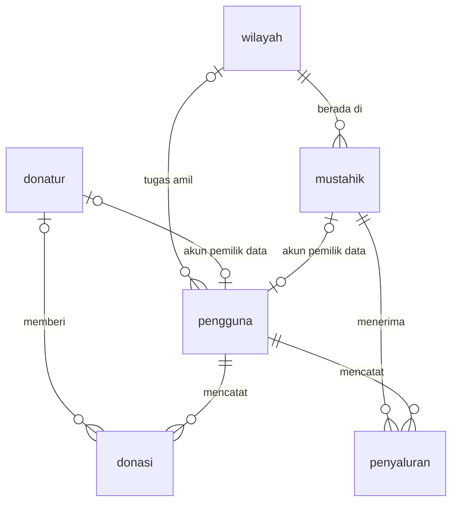

# Arsitektur Tirai

Dokumen ini diperbarui setiap langkah selesai. Bagian yang belum dibangun ditandai "rencana".

## Komponen

| Komponen | Teknologi | Peran |
| --- | --- | --- |
| Tampilan | React + Vite, Motion | Antarmuka pengguna. Tidak pernah dipercaya untuk keputusan akses |
| Server | Node.js + Express | API, pemeriksaan RBAC, enkripsi dan dekripsi kolom, pencatatan audit log |
| Database | SQLite (`node:sqlite`) | Penyimpanan. Kolom sensitif disimpan sebagai ciphertext (rencana langkah 3) |
| Kunci | Variabel lingkungan (`.env`), di luar database | Kunci master dan kunci HMAC NIK (rencana) |

Pada mode produksi, Express juga menyajikan hasil build React dari folder `dist/`, sehingga aplikasi cukup dijalankan sebagai satu proses.

## Prinsip

- Semua keputusan akses diambil di server. Tampilan hanya menampilkan apa yang dikirim server.
- Data yang tidak boleh dilihat suatu peran tidak dikirim ke browser sama sekali, bukan sekadar disembunyikan dengan CSS.

## Database (langkah 1)

Berkas skema: [`src/server/db/skema.sql`](../src/server/db/skema.sql). Alasan tiap kolom: [inventaris-data.md](inventaris-data.md).



| Tabel | Isi |
| --- | --- |
| `wilayah` | Pembagian wilayah tugas amil lapangan (misalnya RW) |
| `donatur` | Nama donatur dan kontak opsional |
| `mustahik` | Penerima: nama, alamat, kondisi, asnaf, wilayah, penanda duplikat NIK |
| `pengguna` | Akun masuk: peran, wilayah (khusus amil), tautan ke data milik sendiri (khusus pemilik data) |
| `donasi` | Dana masuk per jenis ZISWAF |
| `penyaluran` | Dana keluar ke mustahik |

Keputusan teknis:

- Driver: modul `node:sqlite` bawaan Node.js (perlu Node 22.13 atau lebih baru). Tidak perlu paket native yang dikompilasi, jadi pemasangan di laptop anggota tim tidak bergantung pada alat build. Modul ini masih berlabel eksperimental di Node 22, dan peringatannya disembunyikan dengan `--disable-warning=ExperimentalWarning`.
- Semua tabel `STRICT`: SQLite menolak nilai yang tipenya tidak cocok, misalnya teks di kolom nominal.
- Aturan penting ditegakkan di database, tidak hanya di kode: kategori asnaf dan jenis dana dibatasi `CHECK`, nominal harus positif, amil wajib punya wilayah, akun pemilik data wajib tertaut ke tepat satu donatur atau mustahik, dan penanda NIK unik.
- Database dibuat ulang dengan data sintetis setiap server menyala (`data/tirai.db`, tidak masuk git). Perubahan dari aplikasi hilang saat server dimulai ulang. Ini disengaja untuk prototipe dan demo online.
- Donasi boleh tanpa donatur (`donatur_id` kosong) untuk donatur yang memilih tanpa nama.
- `nik_hmac` sudah ada di skema, tetapi baru diisi di langkah 3 bersama kunci HMAC.
- Kata sandi akun disimpan sebagai hash scrypt (modul `crypto` bawaan Node.js) dengan salt acak per akun.

Hal yang perlu dikonfirmasi ke pengurus atau dosen:

- Kategori asnaf memakai delapan golongan penerima zakat (rujukan yang biasa dikutip: QS. At-Taubah: 60 [VERIFIKASI]).
- Wakaf tidak disalurkan langsung ke mustahik di prototipe ini. Ini penyederhanaan.
- Zakat fitrah dicatat dalam rupiah saja, belum dalam bentuk beras.
- Masa simpan tiap data belum ditetapkan. Kolom `dibuat_pada` disiapkan sebagai dasar perhitungannya.

## Login dan RBAC (langkah 2)

Alur satu permintaan:

```
Browser --cookie tirai_sesi--> kenaliPengguna --> wajib(hak) --> rute --> saring menurut peran --> JSON
                                (sesi -> akun)      (401/403)              (kebijakan.js)
```

- Kebijakan hak akses ada di satu berkas: [`src/server/keamanan/kebijakan.js`](../src/server/keamanan/kebijakan.js). Setiap peran mulai dari nol hak, lalu ditambah hanya yang tertulis.
- Ada dua lapis pemeriksaan. Lapis pertama, `wajib(...)`, menentukan apakah peran boleh memanggil endpoint (401 tanpa sesi, 403 tanpa hak). Lapis kedua menyaring isi jawaban: kolom yang tidak boleh dilihat diganti `null` dan dicatat di `tertutup`, sehingga nilai aslinya tidak pernah dikirim ke browser.
- Peran dibaca ulang dari database pada setiap permintaan, jadi perubahan peran oleh admin langsung berlaku.
- Sesi: token acak 32 byte di cookie HttpOnly dan SameSite=Strict, berlaku 8 jam. Database hanya menyimpan hash SHA-256 token.
- Masuk: nama tak terdaftar dan kata sandi salah mendapat jawaban yang sama, dan lama prosesnya disamakan dengan memeriksa hash pengganti. Setelah 5 kali gagal dalam 15 menit, nama pengguna itu dikunci sementara (429). Penghitungnya disimpan di memori, jadi hilang saat server dimulai ulang.
- CSRF: cookie SameSite=Strict, ditambah penolakan permintaan pengubah data yang header `Origin`-nya dari situs lain.
- Header keamanan: Content-Security-Policy `default-src 'self'`, `X-Frame-Options: DENY`, `nosniff`, `Referrer-Policy: no-referrer`. Jawaban API memakai `Cache-Control: no-store`.
- Semua kueri SQL memakai parameter (`?`), tidak pernah menyambung teks masukan ke dalam SQL.

Peragaan di beranda (`/api/peragaan/buku-kas`) memakai fungsi penyaring yang sama dengan akun sungguhan, tetapi tanpa masuk. Ini sengaja dibuat untuk demo dengan data sintetis dan harus dimatikan (`MODE_PERAGAAN=mati`) pada pemasangan dengan data sungguhan.

Daftar endpoint dan hak aksesnya: [api.md](api.md).

## Rencana lanjutan

- Envelope encryption: tiap pemilik data punya kunci data sendiri yang dibungkus kunci master. Penghapusan data pribadi dapat dilakukan dengan memusnahkan kunci data (crypto-shredding), sementara catatan keuangan tetap tersimpan tanpa identitas. Usulan ini perlu keputusan tim dan dosen.
- Audit log append-only, dikunci juga di level database dengan trigger yang menolak UPDATE dan DELETE.
