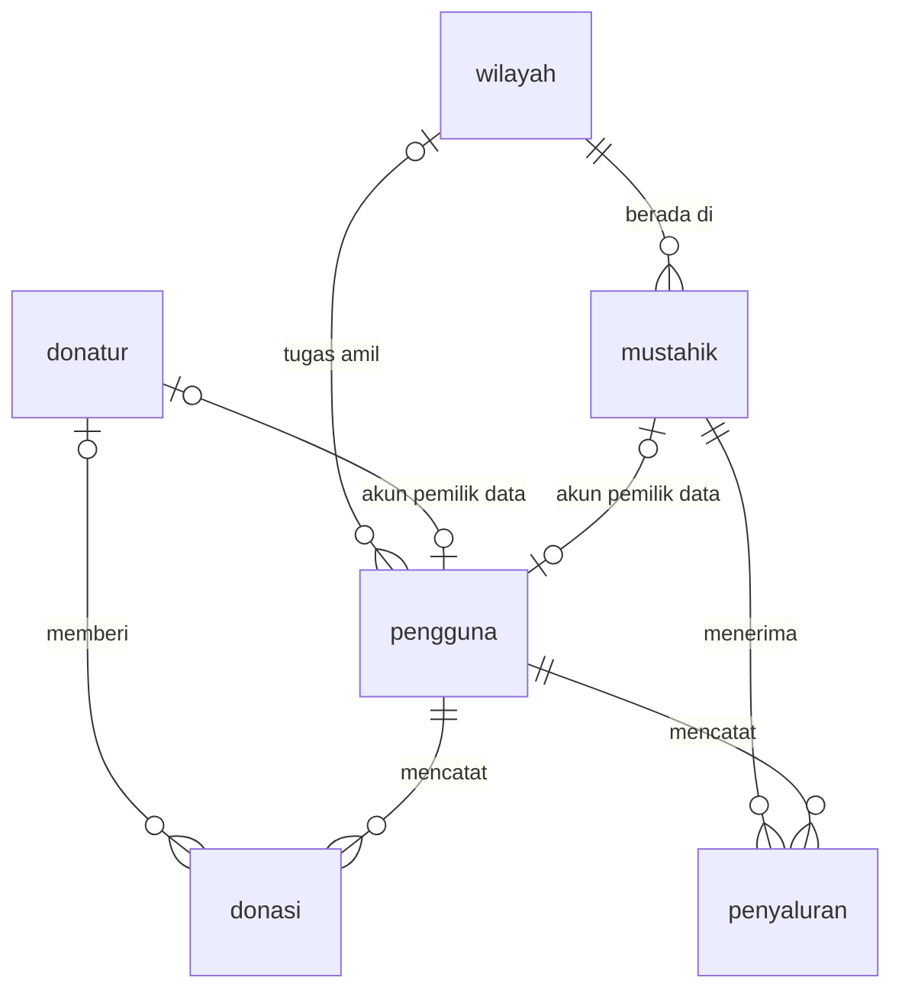

# Arsitektur Tirai

Dokumen ini diperbarui setiap langkah selesai. Bagian yang belum dibangun ditandai "rencana".

## Komponen

| Komponen | Teknologi | Peran |
| --- | --- | --- |
| Tampilan | React + Vite, Motion | Antarmuka pengguna. Tidak pernah dipercaya untuk keputusan akses |
| Server | Node.js + Express | API, pemeriksaan RBAC, enkripsi dan dekripsi kolom, pencatatan audit log |
| Database | SQLite (`node:sqlite`) | Penyimpanan. Kolom sensitif disimpan sebagai ciphertext AES-256-GCM |
| Kunci | Variabel lingkungan (`.env`), di luar database | Kunci master (pembungkus kunci data) dan kunci HMAC NIK |

Pada mode produksi, Express juga menyajikan hasil build React dari folder `dist/`, sehingga aplikasi cukup dijalankan sebagai satu proses.

## Prinsip

- Semua keputusan akses diambil di server. Tampilan hanya menampilkan apa yang dikirim server.
- Data yang tidak boleh dilihat suatu peran tidak dikirim ke browser sama sekali, bukan sekadar disembunyikan dengan CSS.

## Database (langkah 1)

Berkas skema: [`src/server/db/skema.sql`](../src/server/db/skema.sql). Alasan tiap kolom: [inventaris-data.md](inventaris-data.md).



| Tabel | Isi |
| --- | --- |
| `wilayah` | Pembagian wilayah tugas amil lapangan (misalnya RW) |
| `donatur` | Nama donatur dan kontak opsional |
| `mustahik` | Penerima: nama, alamat, kondisi, asnaf, wilayah, penanda duplikat NIK |
| `pengguna` | Akun masuk: peran, wilayah (khusus amil), tautan ke data milik sendiri (khusus pemilik data) |
| `donasi` | Dana masuk per jenis ZISWAF |
| `penyaluran` | Dana keluar ke mustahik |

Keputusan teknis:

- Driver: modul `node:sqlite` bawaan Node.js (perlu Node 22.13 atau lebih baru). Tidak perlu paket native yang dikompilasi, jadi pemasangan di laptop anggota tim tidak bergantung pada alat build. Modul ini masih berlabel eksperimental di Node 22, dan peringatannya disembunyikan dengan `--disable-warning=ExperimentalWarning`.
- Semua tabel `STRICT`: SQLite menolak nilai yang tipenya tidak cocok, misalnya teks di kolom nominal.
- Aturan penting ditegakkan di database, tidak hanya di kode: kategori asnaf dan jenis dana dibatasi `CHECK`, nominal harus positif, amil wajib punya wilayah, akun pemilik data wajib tertaut ke tepat satu donatur atau mustahik, dan penanda NIK unik.
- Database dibuat ulang dengan data sintetis setiap server menyala (`data/tirai.db`, tidak masuk git). Perubahan dari aplikasi hilang saat server dimulai ulang. Ini disengaja untuk prototipe dan demo online.
- Donasi boleh tanpa donatur (`donatur_id` kosong) untuk donatur yang memilih tanpa nama.
- `nik_hmac` berisi HMAC dari NIK, bukan NIK (lihat bagian Enkripsi kolom).
- Kata sandi akun disimpan sebagai hash scrypt (modul `crypto` bawaan Node.js) dengan salt acak per akun.

Hal yang perlu dikonfirmasi ke pengurus atau dosen:

- Kategori asnaf memakai delapan golongan penerima zakat (rujukan yang biasa dikutip: QS. At-Taubah: 60 [VERIFIKASI]).
- Wakaf tidak disalurkan langsung ke mustahik di prototipe ini. Ini penyederhanaan.
- Zakat fitrah dicatat dalam rupiah saja, belum dalam bentuk beras.
- Masa simpan tiap data belum ditetapkan. Kolom `dibuat_pada` disiapkan sebagai dasar perhitungannya.

## Login dan RBAC (langkah 2)

Alur satu permintaan:

```
Browser --cookie tirai_sesi--> kenaliPengguna --> wajib(hak) --> rute --> saring menurut peran --> JSON
                                (sesi -> akun)      (401/403)              (kebijakan.js)
```

- Kebijakan hak akses ada di satu berkas: [`src/server/keamanan/kebijakan.js`](../src/server/keamanan/kebijakan.js). Setiap peran mulai dari nol hak, lalu ditambah hanya yang tertulis.
- Ada dua lapis pemeriksaan. Lapis pertama, `wajib(...)`, menentukan apakah peran boleh memanggil endpoint (401 tanpa sesi, 403 tanpa hak). Lapis kedua menyaring isi jawaban: kolom yang tidak boleh dilihat diganti `null` dan dicatat di `tertutup`, sehingga nilai aslinya tidak pernah dikirim ke browser.
- Peran dibaca ulang dari database pada setiap permintaan, jadi perubahan peran oleh admin langsung berlaku.
- Sesi: token acak 32 byte di cookie HttpOnly dan SameSite=Strict, berlaku 8 jam. Database hanya menyimpan hash SHA-256 token.
- Masuk: nama tak terdaftar dan kata sandi salah mendapat jawaban yang sama, dan lama prosesnya disamakan dengan memeriksa hash pengganti. Setelah 5 kali gagal dalam 15 menit, nama pengguna itu dikunci sementara (429). Penghitungnya disimpan di memori, jadi hilang saat server dimulai ulang.
- CSRF: cookie SameSite=Strict, ditambah penolakan permintaan pengubah data yang header `Origin`-nya dari situs lain.
- Header keamanan: Content-Security-Policy `default-src 'self'`, `X-Frame-Options: DENY`, `nosniff`, `Referrer-Policy: no-referrer`. Jawaban API memakai `Cache-Control: no-store`.
- Semua kueri SQL memakai parameter (`?`), tidak pernah menyambung teks masukan ke dalam SQL.

Peragaan di beranda (`/api/peragaan/buku-kas`) memakai fungsi penyaring yang sama dengan akun sungguhan, tetapi tanpa masuk. Ini sengaja dibuat untuk demo dengan data sintetis dan harus dimatikan (`MODE_PERAGAAN=mati`) pada pemasangan dengan data sungguhan.

Daftar endpoint dan hak aksesnya: [api.md](api.md).

## Enkripsi kolom (langkah 3)

```
MASTER_KEY (.env, di luar database)
   │ membungkus (AES-256-GCM)
   ▼
kunci_data: satu kunci 32 byte per donatur dan per mustahik (tersimpan terbungkus)
   │ mengenkripsi (AES-256-GCM, IV acak, AAD = "tabel.kolom")
   ▼
donatur.kontak, mustahik.nama, mustahik.alamat, mustahik.kondisi  →  "v1:<base64(iv|tag|ciphertext)>"
```

- Kode: [`src/server/keamanan/kripto.js`](../src/server/keamanan/kripto.js) (primitif) dan [`brankas.js`](../src/server/keamanan/brankas.js) (pengelola kunci data). Hanya memakai modul `crypto` bawaan Node.js.
- AAD berisi nama tabel dan kolom. Ciphertext alamat yang dipindah ke kolom nama akan gagal dibuka.
- Database menolak teks biasa di kolom terenkripsi lewat `CHECK (kolom LIKE 'v1:%')`. Kelalaian kode tidak bisa diam-diam menyimpan data asli.
- Dekripsi hanya untuk sel yang lolos RBAC. Buku kas untuk admin tidak mendekripsi apa pun, dan untuk bendahara hanya nama. Ini dibuktikan oleh tes.
- NIK tidak disimpan. Server menghitung HMAC-SHA256 dengan `NIK_HMAC_KEY`, menyimpannya di `nik_hmac` (unik), lalu membuang NIK. Pendaftaran NIK yang sama ditolak 409 tanpa menyebut wilayah tempat NIK itu terdaftar.
- Memusnahkan kunci data membuat ciphertext pemiliknya tidak bisa dibuka lagi. Ini dasar penghapusan di langkah 6.
- `PRAGMA secure_delete = ON`: isi yang dihapus ditimpa nol di berkas database.

Batasan yang perlu ditulis jujur di laporan:

- Server yang sedang berjalan memegang kunci master di memori. Enkripsi kolom melindungi berkas database dan cadangannya yang bocor, bukan server yang sudah dikuasai penyerang. Ini bukan E2EE.
- Kunci data terbungkus disimpan di database yang sama. Cadangan lama yang berisi kunci terbungkus masih bisa dibuka oleh siapa pun yang juga memegang kunci master. Pemusnahan kunci hanya berlaku untuk database yang sedang dipakai.
- Panjang ciphertext mengikuti panjang teks asli. Nama pendek menghasilkan ciphertext pendek.
- Nama donatur tidak dienkripsi, sesuai inventaris data (cukup RBAC). Ini bisa diubah bila tim menilai perlu.
- Bila `MASTER_KEY` kosong, server memakai kunci sementara di memori. Ini cukup untuk prototipe karena database dibuat ulang setiap server menyala. Pada pemasangan sungguhan, kunci wajib diisi dan sebaiknya disimpan di pengelola rahasia, bukan berkas `.env`.

## Audit log (langkah 4)

Tabel `audit_log` mencatat siapa (akun dan peran), kapan, aksi (baca, buat, ubah, ekspor, hapus, masuk, gagal masuk, keluar), jenis data, dan data siapa (nomor donatur, mustahik, atau akun).

- Hanya bisa ditambah. Dua trigger database menolak `UPDATE` dan `DELETE`, termasuk dari luar aplikasi. Aplikasi juga tidak punya endpoint untuk mengubah atau menghapus catatan.
- Tidak memuat data pribadi asli, dan hal ini dijamin oleh skema: semua kolom berupa angka atau pilihan tetap yang dibatasi `CHECK`, tanpa kolom teks bebas. Orang dirujuk lewat nomor. Tes juga mencari semua nama, alamat, kondisi, kontak, NIK, dan kata sandi sintetis di seluruh isi log.
- Membaca daftar dicatat per orang. Bendahara yang membuka buku kas menghasilkan satu catatan umum ditambah satu catatan untuk tiap mustahik yang namanya terlihat. Amil hanya menghasilkan catatan untuk mustahik di wilayahnya. Admin tidak menghasilkan catatan per orang karena tidak melihat identitas siapa pun. Dengan cara ini riwayat akses tiap pemilik data (langkah 6) bisa disusun dari log.
- Gagal masuk dicatat tanpa nama pengguna yang dicoba dan tanpa kata sandinya.
- Membaca audit log juga dicatat.
- Akses dari peragaan beranda dicatat dengan saluran `peragaan`, supaya bisa dibedakan dari akses akun sungguhan.
- Tidak memakai foreign key, sehingga catatan tetap ada setelah data orangnya dihapus. Nomor donatur, mustahik, dan akun memakai `AUTOINCREMENT`, jadi nomor lama tidak pernah berpindah ke orang lain.

Batasan: pemilik berkas database (misalnya admin server) tetap bisa menghapus berkasnya atau mematikan trigger dengan akses langsung ke SQLite. Trigger mencegah perubahan lewat aplikasi dan kelalaian, bukan penyerang yang menguasai server. Untuk itu diperlukan penyimpanan log terpisah atau rantai hash, dan ini di luar cakupan prototipe.
